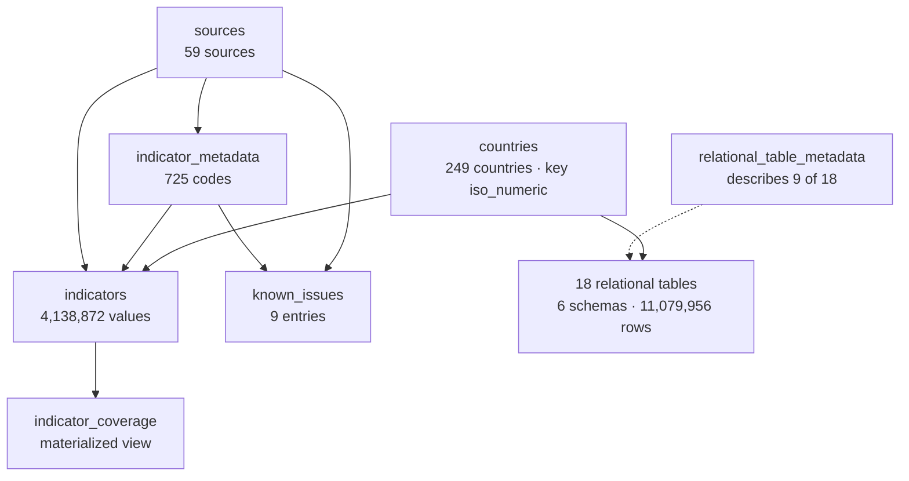
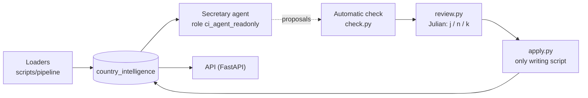

# Project Context — Country Intelligence Layer

**Last updated:** 2026-11-14 · Figures: exact counts from the live database on 14 Nov 2026 (`sql/03_queries/2026-11-14_readme_kennzahlen.sql`)

---

## Vision

A multi-dimensional database that brings country-level data from international sources into one PostgreSQL system. Long-term goal: an interactive, map-centric platform that gives a comprehensive, intuitive view of any country — economy, geography, culture, institutions, environment, history, and lived experience.

The project is not a dashboard that shows numbers. It is a system that answers questions.

> "Where is child mortality high?" · "Which regions are the poorest?" · "Where does a country export its raw materials?" · "How has press freedom changed over the last decade?"

Bolivia (where the project started, during a sabbatical) serves as a recurring analytical anchor, benchmarked against its South American neighbors.

**Portfolio positioning:** end-to-end data pipeline thinking, database architecture, data quality work with evidence, international analytical perspective. Target sector: NGOs, international organizations.

---

## Direction (decided 10 Nov 2026)

| Track | What | Role | Rhythm |
|---|---|---|---|
| **1 Database** | PostgreSQL with all sources, metadata, checks | Foundation for everything, built to last | permanent; **now: clean-up** |
| **2 Platform** | Dashboard, world map, country profiles; API routes underneath; later a search layer ("ask the data") | Main goal, visible layer | continuous, no sprint deadline |
| **3 Short projects** | One question, 5–10 hours, one presentable result | Results, portfolio, learning on real data | each closed on its own |

**Current focus — clean-up:** create structure, uncover errors, set standards (backlog, database audit, secretary agent, source lists, pipeline standard). The agents do the routine work.

**Dependencies:** short projects need clean data (priority-1 errors first). The platform builds on the same data and takes finished short-project results as building blocks.

This replaces the July plan ("Sprint 2: visualization layer" and the v1.0 definition of done). Domain write-ups for the Notion encyclopedia are no longer a goal of their own; knowledge now grows in source guides (written by the secretary) and short projects.

---

## Where Things Live (one place per truth)

| What | Where |
|---|---|
| Data and metadata | The database |
| Open work | Notion backlog (private). **This file keeps no list of open items.** |
| Checked and accepted data facts | Table `known_issues` |
| Working rules | Communication protocol (private project docs) |
| Loader rules | `docs/PIPELINE_STANDARD.md` |
| Sources loaded / not loaded | `docs/SOURCES_AVAILABLE.md` / `docs/SOURCES_CANDIDATES.md` |
| Raw files and which loader reads them | `docs/RAW_INVENTUR_2026-11.md` |
| Secretary agent | `scripts/agent/README.md` |

---

## Conceptual Framework: SIF v2

**v2 restructure (June 2026):** split out *Education, Science & Innovation* and *Infrastructure & Technology* as their own domains, dissolved *Communication & Media* (press freedom → Politics, digital access → Infrastructure), merged *Culture & Identity* + *Social Fabric & Daily Life* into *Culture, Society & Beliefs*.

| # | Domain | Indicators | Note |
|---|--------|-----------:|------|
| 01 | Population & Demographics | 84 | Documented in depth (July 2026) |
| 02 | Health & Survival | 121 | |
| 03 | Education, Science & Innovation | 10 | Thin, needs UNESCO UIS / OECD PISA / WIPO |
| 04 | Economy, Wealth & Labor | 145 | Documented in depth (5/7 categories + composite scores) |
| 05 | Infrastructure & Technology | 17 | Thin, needs ITU / IRENA / ITF |
| 06 | Environment, Climate & Resources | 77 | |
| 07 | Politics, Governance & Law | 124 | Documented in depth (4/4 categories) |
| 08 | Culture, Society & Beliefs | 99 | |
| 09 | History & Collective Memory | 10 | Thin; strong niche sources (Maddison, COLDAT, COW) |
| 10 | International Relations & Global Integration | 38 | Unique sources (UNGA voting, ATOP, KOF) |
| | **Total** | **725** | |

### Data hierarchy (4 levels)

```
Domain        → e.g. Politics, Governance & Law
  Category    → e.g. Security & Conflict
    Dimension → e.g. Armed Conflict
      Indicator → e.g. UCDP:battle_deaths
```

Always "Dimension", never "sub-category". The `category` field in `indicator_metadata` is the SIF level, not the source's own category. Full breakdown: `docs/SIF_DOMAIN_STRUCTURE.md` (last updated July 2026).

---

## Architecture

### Environment

- **Machine:** MacBook (Apple Silicon, macOS) since 25 Oct 2026; before that Windows 11 + WSL2
- **Database:** PostgreSQL 18.6 (Homebrew), database `country_intelligence`
- **Python:** 3.14, `venv/` in the project root
- **Tools:** DBeaver, VS Code, `psql`
- **Credentials:** only in `.env` (not in git)
- **Backup:** `scripts/backup_drive.sh`, run by `launchd` every Sunday at 20:00 (`scripts/launchd/de.julian.ci-backup.plist`): `pg_dump` plus raw data to Google Drive

### Dependencies



*Arrow: builds on. Dashed: describes, without a foreign key. An error in `countries` or `sources` affects everything below it. The relational tables hang only on `countries`; they are not yet linked to `sources`.*

### Core tables (`public`)

| Table | Rows | Content |
|-------|-----:|---------|
| `countries` | 249 | ISO codes, coordinates, region. PK `iso_numeric` |
| `sources` | 59 | Publisher, licence, citation, documentation URL, loaded version and date, update frequency, access method |
| `indicator_metadata` | 725 | See "Metadata format v3" below |
| `indicators` | 4,138,872 | Long format: `iso_numeric`, `indicator_code`, `source_id`, `time_period`, value, `obs_status` |
| `known_issues` | 9 | Checked, accepted data facts, tied to a source or code |
| `relational_table_metadata` | 9 | Grain, join keys, loader, review date of the relational tables |
| `indicator_coverage` | mat. view | Countries, periods, values per code. **Refresh after every load** |
| `v_all_metadata`, `v_country_coverage` | views | Helper views |
| `indicator_catalog` | 4,544 | Search list of WB/WHO indicators **not yet loaded** (snapshot May 2026). Not for names, units or descriptions of loaded indicators |

Of the 59 sources, 41 have values in `indicators` with a `source_id`. 627,967 values have no `source_id` (open clean-up item).

### Relational schemas

| Schema | Tables | Rows | Sources |
|--------|--------|-----:|---------|
| `trade` | `trade_products` (8,163,977), `trade_partners` (1,279,868) | 9,443,845 | UN Comtrade, HS-4, 2000–2025, reloaded Nov 2026 with loader v2 |
| `international` | `diplomatic_relations`, `diplomatic_representation`, `colonial_history` | 1,598,700 | DASID, DDR, COLDAT |
| `politics` | `conflicts_state`, `conflicts_state_actors`, `conflicts_nonstate`, `conflicts_onesided`, `conflict_context`, `marpor_elections`, `political_parties`, `constitutional_events`, `coups` | 23,677 | UCDP, MARPOR, CCP, Cline Center |
| `history` | `ethnic_groups` | 10,769 | EPR |
| `biodiversity` | `species_occurrences` | 2,490 | GBIF (experimental) |
| `culture` | `country_facts`, `national_dishes` | 475 | Curated reference data |

Rule: a schema is named after the topic of its data. Open question: COLDAT sits in `international` although it belongs to the History domain.

### Metadata format v3 (`indicator_metadata`)

Introduced 9–10 Nov 2026 via `sql/05_migrations/`. The column comments in the database hold the rules; the secretary agent reads them.

| Group | Columns |
|---|---|
| Identity | `indicator_code`, `name`, `source_id`, `domain`, `category`, `dimension`, `loader_script`, `status`, `added_at` |
| Meaning | `description` (exactly one sentence, max. 200 characters, high value = "more of it"), `key_info` (1–5 points), `producer_definition`, `value_labels`, `unit` (only real units) |
| Interpretation | `direction`, `scale_type`, `scale_min`, `scale_max`, `data_origin`, `temporal_type`, `is_lead_indicator`, `keywords`, `reference` |
| Review | `metadata_reviewed_at` (set only by `apply.py`) |

Status 14 Nov 2026: 489 codes have a description, **367 are fully reviewed** (WB 251/253, VDEM 59/59, PWT 21/21, UNDP 19/19, GITOC 17/17).

### Indicator code convention

```
SOURCE:ORIGINAL_CODE
Examples: WB:NY.GDP.PCAP.CD · VDEM:v2x_polyarchy · UNDP:hdi · UNVOTE:agree_usa · UCDP:battle_deaths
```

**Never invent codes**: original source codes are always preserved.

### Design principles

These are the rules. Older loaders do not all follow them yet; they are brought in line when they are touched.


- `time_period` as TEXT: `"2023"`, `"2023-01"`, `"static"` (rule for `static` fixed 14 Nov 2026)
- `source_id` in the UNIQUE key allows parallel storage from several sources. NULL in a unique key breaks the rule, so every value needs a source.
- `obs_status`: A=actual, E=estimated, P=provisional, F=forecast
- Loaders are re-runnable and use `ON CONFLICT DO UPDATE`; `DO NOTHING` silently keeps stale values
- Errors are reported loudly, never swallowed; an empty result is a finding, not a success
- Every schema change is a dated file in `sql/05_migrations/` with counts before and after
- Metadata is created together with the data, never afterwards
- New formats and columns are piloted on a few real cases before they become standard

---

## Who Writes, Who Reads



Only two paths write to the database: **the loaders** and **`apply.py`**, which Julian starts after `review.py`. The secretary and the API only read.

### Secretary agent (`scripts/agent/`)

Runs on the Claude Agent SDK with Sonnet as the default model. Reads the database as `ci_agent_readonly`, downloads and reads codebooks, and writes proposals with evidence into a run folder (`scripts/agent/output/`, not in git).

| Step | Who | Command | Result |
|---|---|---|---|
| 1 Run | Agent | `secretary.py "task" --thema x` or `batch.py` | Proposals, self-check |
| 2 Automatic check | Script, no AI | automatic (`check.py <run>`) | ✅ / ⚠️ / ❌ per proposal |
| 3 Review | Julian | `review.py <run>` | yes / no / known issue, saved in `review.json` |
| 4 Transfer | Julian | `apply.py <run>` | Backup, one transaction, exactly one row per UPDATE, before/after control, undo SQL |

Further tools: `status.py` (overview and next command per run), `ask.py` (questions to the database), `beschreibung.py` (rewrite only the descriptions of a run). Besides metadata, the secretary writes **source guides**, which are published to Notion.

---

## Pipeline

- Loaders live in `scripts/pipeline/<domain>/`.
- New and reworked loaders follow `docs/PIPELINE_STANDARD.md`: duties P1–P19, a migration pattern, and the ILO loader as the first worked case.
- After three cases of different types (API, file download, large relational data), a shared module `scripts/pipeline/lib` will be built. Other loaders move over when they are touched next, not in one mass change.
- Raw data: `data/raw/` holds 469 files, 6.6 GB, inventoried on 14 Nov 2026. Several loaders still point to old paths.

**Reproducibility:** a from-scratch rebuild is not yet possible from the repo alone. The relational schemas have no DDL here, and some early World Bank indicators still need `scripts/archive/wb_legacy/`. The working database is restored from the weekly backup.

---

## API Layer (FastAPI)

```
GET /api/country/{iso}                          → Country overview + top KPIs
GET /api/country/{iso}/demography               → Domain overview (category cards)
GET /api/country/{iso}/demography/{category}    → Category detail + time series
GET /api/country/{iso}/demography/pyramid       → Age pyramid
GET /api/country/{iso}/timeseries/{indicator}   → Generic time series
GET /api/country/{iso}/governance               → Flat, filters on old domain names
GET /api/country/{iso}/economy                  → Flat, filters on old domain names
```

Navigation concept: Country overview (map + top KPIs) → Domain overview (category cards) → Category detail (all indicators + time series). Demography is built on this blueprint. Governance and Economy still filter on pre-v2 domain names and need to be updated before the platform uses them.
