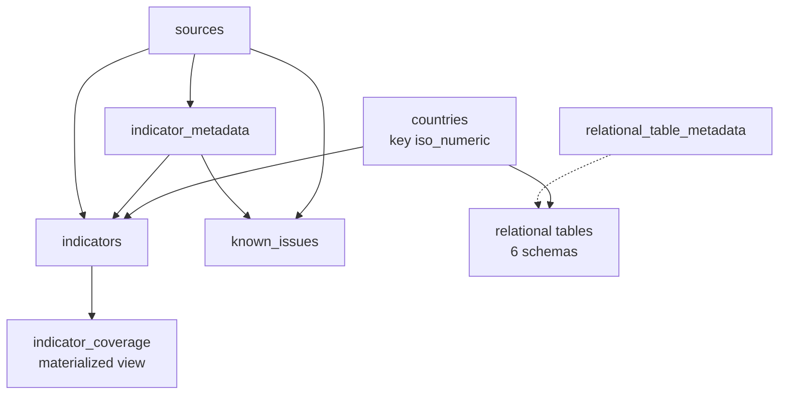
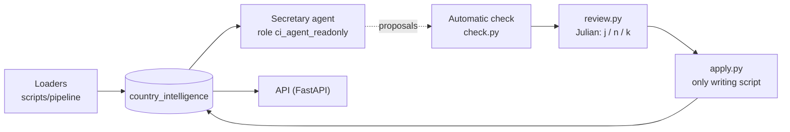

# Project Context — Country Intelligence Layer

**Last updated:** 2026-11-28 · Structure and status. **All exact figures sit in one block, "Key figures", and come from `sql/03_queries/2026-11-14_readme_kennzahlen.sql`.** To refresh them, run that query; the rest of this file is kept free of counts so it does not go stale.

---

## Vision

A multi-dimensional database that brings country-level data from international sources into one PostgreSQL system. Long-term goal: an interactive, map-centric platform that gives a comprehensive, intuitive view of any country — economy, geography, culture, institutions, environment, history, and lived experience.

The project is not a dashboard that shows numbers. It is a system that answers questions.

> "Where is child mortality high?" · "Which regions are the poorest?" · "Where does a country export its raw materials?" · "How has press freedom changed over the last decade?"

Bolivia (where the project started, during a sabbatical) serves as a recurring analytical anchor, benchmarked against its South American neighbors.

**Portfolio positioning:** end-to-end data pipeline thinking, database architecture, data quality work with evidence, international analytical perspective. Target sector: NGOs, international organizations.

---

## Direction (10 Nov 2026, milestone 15–23 Nov 2026)

| Track | What | Role | Rhythm |
|---|---|---|---|
| **1 Database** | PostgreSQL with all sources, metadata, checks | Foundation for everything, built to last | permanent; **now: clean-up** |
| **2 Platform** | Dashboard, world map, country profiles; API routes underneath; later a search layer ("ask the data") | Main goal, visible layer | continuous, no sprint deadline |
| **3 Short projects** | One question, 5–10 hours, one presentable result | Results, portfolio, learning on real data | each closed on its own |

**Current focus — clean-up:** create structure, uncover errors, set standards (backlog, database audit, secretary agent, source lists, pipeline standard). The agents do the routine work.

**Dependencies:** short projects need clean data (priority-1 errors first). The platform builds on the same data and takes finished short-project results as building blocks.

**Milestone "DB v1.0" (deadline 1 Dec 2026):** every known error is fixed or documented in `known_issues`, measured by the readiness check (`sql/03_queries/2026-11-15_readiness_check.sql`, six checkpoints: load errors, country mapping, structure, metadata, documented limits, backup). New findings join v1.0 only if they are data errors in values already loaded. The taxonomy (domain → category → dimension) is not part of v1.0. **The database is authoritative; Notion follows.**

**After v1.0:** getting to know the data through relationships between concepts (pilot: democracy × prosperity, with Bolivia as the thread), combined with preparation for an SQL certification. Small topics run alongside as a buffer.

This replaces the July plan ("Sprint 2: visualization layer" and the v1.0 definition of done). Domain write-ups for the Notion encyclopedia are no longer a goal of their own; knowledge now grows in source guides (written by the secretary) and short projects.

---

## Where Things Live (one place per truth)

| What | Where |
|---|---|
| Data and metadata | The database |
| Open work | Notion backlog (private). **This file keeps no list of open items.** |
| Checked and accepted data facts | Table `known_issues` |
| Decisions, dated | `docs/ENTSCHEIDUNGEN.md` (German) |
| Working rules | `CLAUDE.md` (short, loaded by Claude Code at every start), details in `docs/ARBEITSREGELN.md` (German) |
| Commands, checked against the code | `docs/BEFEHLE.md` (German) |
| Loader rules | `docs/PIPELINE_STANDARD.md` |
| Sources loaded / not loaded | `docs/SOURCES_AVAILABLE.md` / `docs/SOURCES_CANDIDATES.md` |
| Raw files and which loader reads them | `docs/RAW_INVENTUR_2026-11.md` |
| Secretary agent | `scripts/agent/README.md` |
| Readiness check results | `logs/readiness/` (not in git) |
| Archive of earlier chat notes | `kontext/` (local only, not in git) |

---

## Key figures

**As of 28 Nov 2026**, exact counts from the live database (`sql/03_queries/2026-11-14_readme_kennzahlen.sql`, output `logs/2026-11-28_kennzahlen.txt`). PostgreSQL 18.6.

| Figure | Value |
|---|---:|
| Values in `indicators` | 4,091,229 |
| Values without `source_id` | 0 |
| Rows in relational tables (18 tables, 6 schemas) | 11,079,948 |
| of which `trade` | 9,443,845 |
| **Rows in total** (values + relational) | **15,171,177** |
| Countries (`countries`) | 249 |
| Sources (`sources`) / with values in `indicators` | 59 / 48 |
| Indicator codes / active / with data | 725 / 722 / 717 |
| Codes with description / fully reviewed | 610 / 604 |
| `known_issues` | 38 |
| Relational tables described in `relational_table_metadata` | 9 of 18 |

Rows per schema: `trade` 9,443,845, `international` 1,598,700, `politics` 23,677, `history` 10,763, `biodiversity` 2,490, `culture` 473.

Fully reviewed sources (32): ACLED, ATOP, CAF_WGI, EDELMAN, EI, EIA, EMBER, FAO_FOOD, FAO_FOOD_GRP, GITOC, GLOTTOLOG, HENLEY, HOFSTEDE, ILO, KOF, NOBEL, OWID_CO2, PEW_REL, POLITY5, PWT, RSF, TI, UCDP, UNDP, UNESCO_ICH, UNESCO_WHC, UNHCR, UNVOTE, VDEM, WEF_GGGI, WHR, WID; partly: WB 251/253.

Indicators per domain: Culture, Society & Beliefs 99; Economy, Wealth & Labor 145; Education, Science & Innovation 10; Environment, Climate & Resources 77; Health & Survival 121; History & Collective Memory 10; Infrastructure & Technology 17; International Relations & Global Integration 38; Politics, Governance & Law 124; Population & Demographics 84.

---

## Conceptual Framework: SIF v2

**v2 restructure (June 2026):** split out *Education, Science & Innovation* and *Infrastructure & Technology* as their own domains, dissolved *Communication & Media* (press freedom → Politics, digital access → Infrastructure), merged *Culture & Identity* + *Social Fabric & Daily Life* into *Culture, Society & Beliefs*.

| # | Domain | Note |
|---|--------|------|
| 01 | Population & Demographics | Encyclopedia write-up (July 2026) |
| 02 | Health & Survival | |
| 03 | Education, Science & Innovation | Thin; candidates UNESCO UIS, OECD PISA, WIPO |
| 04 | Economy, Wealth & Labor | Encyclopedia write-up (5/7 categories + composite scores) |
| 05 | Infrastructure & Technology | Thin; candidates ITU, IRENA, ITF |
| 06 | Environment, Climate & Resources | |
| 07 | Politics, Governance & Law | Encyclopedia write-up (4/4 categories) |
| 08 | Culture, Society & Beliefs | |
| 09 | History & Collective Memory | Thin; strong niche sources (Maddison, COLDAT, COW) |
| 10 | International Relations & Global Integration | Unique sources (UNGA voting, ATOP, KOF) |

Indicators per domain: see "Key figures".

### Data hierarchy (4 levels)

```
Domain        → e.g. Politics, Governance & Law
  Category    → e.g. Security & Conflict
    Dimension → e.g. Armed Conflict
      Indicator → e.g. UCDP:battle_deaths
```

Always "Dimension", never "sub-category". The `category` field in `indicator_metadata` is the SIF level, not the source's own category. Full breakdown: `docs/SIF_DOMAIN_STRUCTURE.md` (last updated July 2026).

---

## Architecture

### Environment

- **Machine:** MacBook (Apple Silicon, macOS) since 25 Oct 2026; before that Windows 11 + WSL2
- **Database:** PostgreSQL 18.6 (Homebrew), database `country_intelligence`
- **Python:** 3.14, `venv/` in the project root
- **Tools:** DBeaver, VS Code, `psql`
- **Credentials:** only in `.env` (not in git)
- **Backup:** `scripts/backup_drive.sh`, run by `launchd` every Sunday at 20:00 (`scripts/launchd/de.julian.ci-backup.plist`): `pg_dump` to Google Drive; raw data are backed up separately
- **Claude Code** is the working tool from late Nov 2026 (rules in `CLAUDE.md`); before that, Claude worked through claude.ai with a connection to the Mac
- **Home server:** a Proxmox host with an Ubuntu development VM exists. It joins the project only after the move to Claude Code; until then the Mac and its database are the working place

### Dependencies



*Arrow: builds on. Dashed: describes, without a foreign key. An error in `countries` or `sources` affects everything below it. The relational tables hang only on `countries`; they are not yet linked to `sources`.*

### Core tables (`public`)

| Table | Content |
|-------|---------|
| `countries` | ISO codes, coordinates, region. PK `iso_numeric` |
| `sources` | Publisher, licence, citation, documentation URL, loaded version and date, update frequency, access method |
| `indicator_metadata` | See "Metadata format v3" below |
| `indicators` | Long format: `iso_numeric`, `indicator_code`, `source_id` (**NOT NULL since 15 Nov 2026**), `time_period`, value, `obs_status` |
| `known_issues` | Checked, accepted data facts, tied to a source or code (status `accepted` or `to_fix`) |
| `relational_table_metadata` | Grain, join keys, loader, review date of the relational tables |
| `indicator_coverage` | Materialized view: countries, periods, values per code. **Refresh after every load** |
| `v_all_metadata`, `v_country_coverage` | Helper views |
| `indicator_catalog` | Search list of WB/WHO indicators **not yet loaded** (snapshot May 2026). Not for names, units or descriptions of loaded indicators |

The relational tables hang only on `countries`; they are not yet linked to `sources`.

### Relational schemas

| Schema | Tables | Sources |
|--------|--------|---------|
| `trade` | `trade_products`, `trade_partners` | UN Comtrade, HS-4, 2000–2025, reloaded Nov 2026 with loader v2 |
| `international` | `diplomatic_relations`, `diplomatic_representation`, `colonial_history` | DASID, DDR, COLDAT |
| `politics` | `conflicts_state`, `conflicts_state_actors`, `conflicts_nonstate`, `conflicts_onesided`, `conflict_context`, `marpor_elections`, `political_parties`, `constitutional_events`, `coups` | UCDP, MARPOR, CCP, Cline Center |
| `history` | `ethnic_groups` | EPR |
| `biodiversity` | `species_occurrences` | GBIF (experimental) |
| `culture` | `country_facts`, `national_dishes` | Curated reference data |

Rule: a schema is named after the topic of its data. Open question: COLDAT sits in `international` although it belongs to the History domain.

### Metadata format v3 (`indicator_metadata`)

Introduced 9–10 Nov 2026 via `sql/05_migrations/`. The column comments in the database hold the rules; the secretary agent reads them.

| Group | Columns |
|---|---|
| Identity | `indicator_code`, `name`, `source_id`, `domain`, `category`, `dimension`, `loader_script`, `status`, `added_at` |
| Meaning | `description` (exactly one sentence, max. 200 characters, high value = "more of it"), `key_info` (1–5 points), `producer_definition`, `value_labels`, `unit` (only real units) |
| Interpretation | `direction`, `scale_type`, `scale_min`, `scale_max`, `data_origin`, `temporal_type`, `is_lead_indicator`, `keywords`, `reference` |
| Review | `metadata_reviewed_at` (set only by `apply.py`) |

Progress (described / fully reviewed codes, per source): see "Key figures". Since 24 Nov 2026 the secretary also writes a short **box** (Was · Wer · Umfang · Art der Werte · Nutzung · Vorsicht) for each dataset page in Notion.

### Indicator code convention

```
SOURCE:ORIGINAL_CODE
Examples: WB:NY.GDP.PCAP.CD · VDEM:v2x_polyarchy · UNDP:hdi · UNVOTE:agree_usa · UCDP:battle_deaths
```

`SOURCE` is the `short_code` of the dataset, i.e. its **originator** (since 24 Nov 2026). If a dataset is obtained through an aggregator (OWID, QoG), that route is recorded in `loader_script` and `reference`, not in the prefix. **Never invent codes**: the part after the colon is always the original source code.

### Design principles

These are the rules. Older loaders do not all follow them yet; they are brought in line when they are touched.


- `time_period` as TEXT: `"2023"`, `"2023-01"`, `"static"` (rule for `static` fixed 14 Nov 2026)
- `source_id` in the UNIQUE key allows parallel storage from several sources. NULL in a unique key breaks the rule, so every value needs a source.
- `obs_status`: A=actual, E=estimated, P=provisional, F=forecast
- Loaders are re-runnable and use `ON CONFLICT DO UPDATE`; `DO NOTHING` silently keeps stale values
- Errors are reported loudly, never swallowed; an empty result is a finding, not a success
- Every schema change is a dated file in `sql/05_migrations/` with counts before and after
- Metadata is created together with the data, never afterwards
- New formats and columns are piloted on a few real cases before they become standard
- **Country mapping only by exact match or an explicit list per source** (with valid-from/to years); no fuzzy or substring matching; an unknown name or code stops the run (P9)
- **The dry run with an old-versus-new comparison is the acceptance test** of a reworked loader: all old values equal, every difference is a finding
- Historical states (e.g. GDR, USSR) are dropped for v1.0 and documented; they are to be loaded later as units of their own

---

## Who Writes, Who Reads



Only two paths write to the database: **the loaders** and **`apply.py`**, which Julian starts after `review.py`. The secretary and the API only read.

### Secretary agent (`scripts/agent/`)

Runs on the Claude Agent SDK with Sonnet as the default model. Reads the database as `ci_agent_readonly`, downloads and reads codebooks, and writes proposals with evidence into a run folder (`scripts/agent/output/`, not in git).

| Step | Who | Command | Result |
|---|---|---|---|
| 1 Run | Agent | `secretary.py "task" --thema x` or `batch.py` | Proposals, self-check |
| 2 Automatic check | Script, no AI | automatic (`check.py <run>`) | ✅ / ⚠️ / ❌ per proposal |
| 3 Review | Julian | `review.py <run>` | yes / no / known issue, saved in `review.json` |
| 4 Transfer | Julian | `apply.py <run>` | Backup, one transaction, exactly one row per UPDATE, before/after control, undo SQL |

Further tools: `status.py` (overview and next command per run), `ask.py` (questions to the database), `beschreibung.py` (rewrite only the descriptions of a run). Besides metadata, the secretary writes **source guides** (12 sections) and the **box** for each dataset page in Notion. Several runs can be chained in a series script (`scripts/agent/serie_<date>.sh`), never two in parallel. Commands: `docs/BEFEHLE.md`.

---

## Pipeline

- Loaders live in `scripts/pipeline/<domain>/`.
- New and reworked loaders follow `docs/PIPELINE_STANDARD.md`: duties P1–P19, a migration pattern, and the ILO loader as the first worked case.
- The shared module `scripts/pipeline/lib/` started with the **central country mapping** (`laender.py`, one list per source, with tests). Loaders that matched country names fuzzily, by substring or through a package were **locked** on 24 Nov 2026 (CI-172) and stop with a message until they are moved to the module. Seven reworked loaders (Freedom House, Henley, TI, WHR, GITOC, FSI, KOF) are in the repo; their live run is pending.
- **Two kinds of loaders:** reworked loaders do a dry run by default and write only with `--schreiben`; older loaders without options write immediately. Details in `docs/BEFEHLE.md`.
- Raw data live in `data/raw/` (inventory: `docs/RAW_INVENTUR_2026-11.md`). Several loaders still point to old paths; a flat layout by source is decided but not yet carried out.

**Reproducibility:** a from-scratch rebuild is not yet possible from the repo alone. The relational schemas have no DDL here, and some early World Bank indicators still need `scripts/archive/wb_legacy/`. The working database is restored from the weekly backup.

---

## API Layer (FastAPI)

```
GET /api/country/{iso}                          → Country overview + top KPIs
GET /api/country/{iso}/demography               → Domain overview (category cards)
GET /api/country/{iso}/demography/{category}    → Category detail + time series
GET /api/country/{iso}/demography/pyramid       → Age pyramid
GET /api/country/{iso}/timeseries/{indicator}   → Generic time series
GET /api/country/{iso}/governance               → Flat, filters on old domain names
GET /api/country/{iso}/economy                  → Flat, filters on old domain names
```

Navigation concept: Country overview (map + top KPIs) → Domain overview (category cards) → Category detail (all indicators + time series). Demography is built on this blueprint. Governance and Economy still filter on pre-v2 domain names and need to be updated before the platform uses them.
