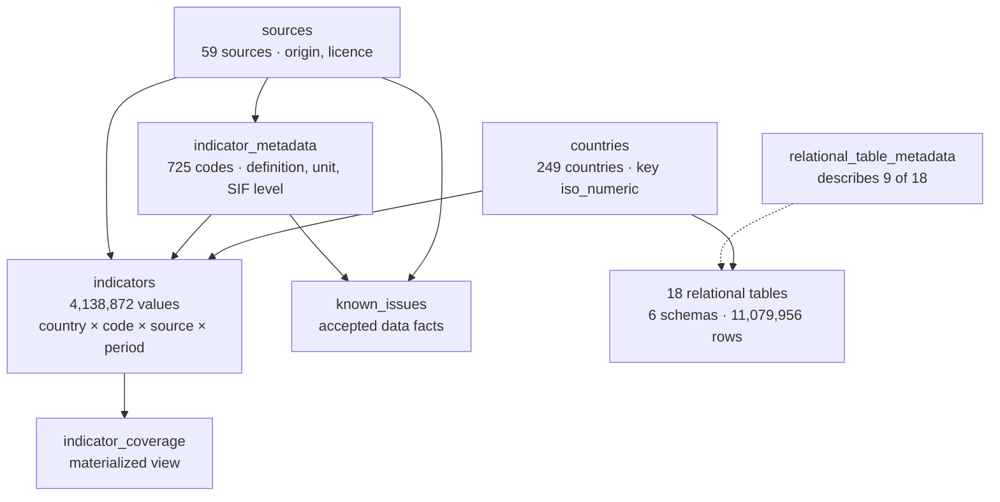
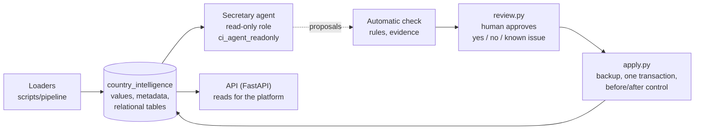

# Country Intelligence Layer

A PostgreSQL database that brings country-level data from **59 registered international sources** into one system: **4.1 million indicator values** and **11.1 million rows of relational data** (trade flows, diplomatic relations, conflicts, elections), about **15.2 million data points** in total. Built to answer questions about countries, not just show numbers.

> "Where is child mortality high?" · "Where does a country export its raw materials?" · "How has press freedom changed over the last decade?"

Started in Cochabamba, Bolivia, during a sabbatical in 2026. Bolivia serves as a recurring analytical anchor, benchmarked against its South American neighbors.

*All figures in this README: exact counts from the live database on 14 Nov 2026 (`sql/03_queries/2026-11-14_readme_kennzahlen.sql`).*

---

## Direction (since November 2026)

The project runs on three tracks:

| Track | What | Role |
|---|---|---|
| **1 Database** | PostgreSQL with all sources, metadata and checks | The foundation, built to last. **Current focus: clean-up** (errors found and fixed, standards set, every indicator described and reviewed) |
| **2 Platform** | Dashboard, world map, country profiles, later a search layer ("ask the data") | The main goal, built continuously without a deadline |
| **3 Short projects** | One question, 5–10 hours, one presentable result | Results and learning on real data |

---

## Conceptual Framework

The data is organized by the **Societal Intelligence Framework (SIF v2)**: 10 domains that cover a society from measurable structure to lived experience. Every indicator sits in a **4-level hierarchy**: `Domain → Category → Dimension → Indicator`.

| # | Domain | Indicators |
|---|--------|-----------:|
| 01 | Population & Demographics | 84 |
| 02 | Health & Survival | 121 |
| 03 | Education, Science & Innovation | 10 |
| 04 | Economy, Wealth & Labor | 145 |
| 05 | Infrastructure & Technology | 17 |
| 06 | Environment, Climate & Resources | 77 |
| 07 | Politics, Governance & Law | 124 |
| 08 | Culture, Society & Beliefs | 99 |
| 09 | History & Collective Memory | 10 |
| 10 | International Relations & Global Integration | 38 |
| | **Total** | **725** |

Domains 03, 05 and 09 are thin and need new sources. The full category/dimension breakdown is in `docs/SIF_DOMAIN_STRUCTURE.md`.

---

## Data Sources

Each source has one home domain, even when its data feeds several. This mirrors `docs/SOURCES_AVAILABLE.md`, which lists every source with its codes, values, coverage, status and loader. The mix of standard aggregators (World Bank, WHO, UNDP) **and** specialist sources that most portfolios don't touch (ATOP alliances, UN General Assembly voting, COLDAT colonial history, MARPOR party manifestos) is deliberate.

| # | Domain | Sources |
|---|--------|---------|
| 01 | Population & Demographics | UNHCR |
| 02 | Health & Survival | WHO, UNDP, FAOSTAT Food Balance Sheets (incl. Food Groups), Global Hunger Index |
| 03 | Education, Science & Innovation | Nobel Prize |
| 04 | Economy, Wealth & Labor | World Bank (WDI + WGI), WID.world, Penn World Table 11.0, ILOSTAT, UN Comtrade* |
| 05 | Infrastructure & Technology | U.S. EIA |
| 06 | Environment, Climate & Resources | OWID CO₂, FAOSTAT Land Use, Energy Institute, Ember, Open-Meteo ERA5, GBIF* |
| 07 | Politics, Governance & Law | V-Dem, Polity5, Freedom House, ACLED, UCDP*, UNODC, SIPRI, GI-TOC, Transparency International, Fragile States Index, RSF Press Freedom, WEF Global Gender Gap, MARPOR*, Comparative Constitutions Project*, Cline Center coups* |
| 08 | Culture, Society & Beliefs | World Values Survey, Hofstede, World Happiness Report, Pew Research, Edelman Trust Barometer, CAF World Giving Index, UNESCO (World Heritage + Intangible Heritage), Glottolog, IMDb, samayo/country-json* |
| 09 | History & Collective Memory | Maddison Project, Correlates of War, EPR Ethnic Power Relations*, COLDAT* |
| 10 | International Relations & Global Integration | UNGA voting, KOF Globalisation Index, ATOP, COW IGO membership, Henley Passport Index, DASID*, DDR* |
| – | Base data | RestCountries (country master data) |

*\* also or only as relational tables.*

Sources not yet loaded, by domain: `docs/SOURCES_CANDIDATES.md`.

---

## Architecture

The database has a core in the `public` schema and six schemas with relational tables. Everything hangs on the country key `iso_numeric` in `countries`.



*Arrow: builds on. Dashed: describes, without a foreign key.*

### Core tables (`public`)

| Table | Rows | Content |
|-------|-----:|---------|
| `countries` | 249 | ISO codes, coordinates, region. PK `iso_numeric` (ISO 3166-1) |
| `sources` | 59 | Publisher, licence, citation, loaded version, update frequency |
| `indicator_metadata` | 725 | One row per indicator: name, unit, SIF level, definition, direction, scale, data origin, key facts (format v3) |
| `indicators` | 4,138,872 | Values in long format (country × indicator × source × period), SDMX-inspired |
| `known_issues` | 9 | Data facts that were checked and deliberately accepted |
| `relational_table_metadata` | 9 | Grain, join keys and loader of the relational tables |
| `indicator_coverage` | view | Countries, periods and values per indicator. Refresh after every load: `REFRESH MATERIALIZED VIEW indicator_coverage;` |
| `indicator_catalog` | 4,544 | Search list of WB/WHO indicators not yet loaded (snapshot May 2026). For loaded indicators use `indicator_metadata` |

### Relational schemas

| Schema | Tables | Rows | Content |
|--------|--------|-----:|---------|
| `trade` | `trade_products`, `trade_partners` | 9,443,845 | UN Comtrade, HS-4 product flows and bilateral partners, 2000–2025 (fully reloaded Nov 2026) |
| `international` | `diplomatic_relations`, `diplomatic_representation`, `colonial_history` | 1,598,700 | DASID, DDR, COLDAT |
| `politics` | 9 tables (UCDP conflicts, `conflict_context`, MARPOR elections and parties, constitutional events, coups) | 23,677 | UCDP, MARPOR, CCP, Cline Center |
| `history` | `ethnic_groups` | 10,769 | EPR ethnic power relations 1946–2023 |
| `biodiversity` | `species_occurrences` | 2,490 | GBIF (experimental) |
| `culture` | `country_facts`, `national_dishes` | 475 | Curated reference data |

### Indicator code convention

```
SOURCE:ORIGINAL_CODE
Examples: WB:NY.GDP.PCAP.CD · VDEM:v2x_polyarchy · UNDP:hdi · UNVOTE:agree_usa
```

Original source codes are always preserved, never invented.

---

## Metadata and the Secretary Agent

Each indicator is meant to carry a reviewed description, not just a name. An AI agent (the **"secretary"**, built on the Claude Agent SDK) reads source documentation and codebooks and **proposes** metadata with evidence for each claim. It never writes to the database.



*Only two paths write to the database: the loaders and `apply.py`, started by a human after review.*

**Status (14 Nov 2026):** 367 of 725 indicators are fully described and reviewed: World Bank 251/253, V-Dem 59/59, Penn World Table 21/21, UNDP 19/19, GI-TOC 17/17. Details: `scripts/agent/README.md`.

---

## Known Limitations

Open issues are tracked in a private backlog. The most important ones affecting the data:

- **627,967 values in `indicators` have no `source_id`.** Without a source, the unique rule cannot catch duplicate rows.
- The relational tables are not yet linked to their source in `sources`, and the DDL of the relational schemas is not yet in the repo.
- Several loaders still expect raw files in old locations (`docs/RAW_INVENTUR_2026-11.md`). New and reworked loaders follow `docs/PIPELINE_STANDARD.md`.

---

## Tech Stack

- **PostgreSQL 18** (Homebrew, macOS on Apple Silicon)
- **Python 3.14**: data pipeline, agent, API
- **FastAPI**: REST API · **Streamlit**: indicator explorer (early stage)
- **Claude Agent SDK**: secretary agent
- **psycopg2 · pandas · requests · pygbif · openpyxl · pycountry**
- **DBeaver**, **VS Code**
- **Backup:** weekly `pg_dump` and raw data to Google Drive via `launchd` (`scripts/backup_drive.sh`)

---

## Project Structure

```
country-intelligence/
├── scripts/
│   ├── pipeline/          # Loaders by domain (base, economy, health, demographics,
│   │                      # environment, governance, culture, history, international, social)
│   ├── agent/             # Secretary agent: secretary.py, review.py, apply.py, status.py
│   ├── catalog/           # Old indicator catalog + search tools (WB/WHO)
│   ├── analysis/          # Exploration scripts
│   ├── experimental/      # Work in progress, not production
│   ├── archive/           # wb_legacy/: superseded WB loaders
│   ├── launchd/           # Schedule for the weekly backup
│   ├── backup_drive.sh    # Backup: pg_dump + raw data to Google Drive
│   └── check_sources.py   # Checks the source lists against the database
├── sql/
│   ├── 01_setup/          # Core table creation
│   ├── 02_seed/           # Initial data + SIF mapping
│   ├── 03_queries/        # Audits, controls, data quality
│   ├── 04_categories/     # Category assignment per domain
│   └── 05_migrations/     # Dated schema changes, each with before/after checks
├── api/                   # FastAPI app and routes
├── docs/                  # SIF structure, source lists, pipeline standard, raw data inventory
├── data/raw/              # Raw files (not in git)
├── backups/, logs/        # Local only (not in git)
├── PROJECT_CONTEXT.md
└── README.md
```

---

## Setup

```bash
# 1. Clone & install
git clone https://github.com/Julian-Endres/country-intelligence
cd country-intelligence
python3 -m venv venv && source venv/bin/activate
pip install -r requirements.txt

# 2. Database (core tables)
createdb country_intelligence
psql -d country_intelligence -f sql/01_setup/01_drop_tables.sql
psql -d country_intelligence -f sql/01_setup/02_create_sources.sql
psql -d country_intelligence -f sql/01_setup/03_create_countries.sql
psql -d country_intelligence -f sql/01_setup/04_create_indicator_metadata.sql
psql -d country_intelligence -f sql/01_setup/05_create_indicators.sql
# then the files in sql/05_migrations/ in date order

# 3. Configure
cp .env.example .env  # DB credentials + API keys

# 4. Load base data
python3 scripts/pipeline/base/load_countries.py
```

A full rebuild from the repo alone is not yet possible: the relational schemas have no DDL here, and a few early World Bank indicators still need `scripts/archive/wb_legacy/`. The working database is restored from backup.

---

## Status

- ✅ 59 sources, 725 indicators across all 10 SIF domains, ~15.2M data points
- ✅ Comtrade fully reloaded (Nov 2026): 2000–2023 with 165–180 reporting countries per year
- ✅ Metadata format v3 and review workflow; 367 indicators described and reviewed
- ✅ Weekly automatic backup
- ✅ Three domains documented in depth (Population, Economy, Politics), Bolivia vs. South America
- ⏳ Clean-up: values without source, loader standard, raw data paths
- ⏳ Describe the remaining sources with the secretary agent
- ⏳ Platform: API routes to blueprint level, dashboard, world map
